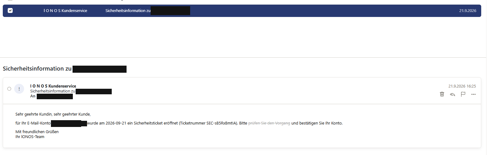

# Case 01 – E-Mail-Analyse: „Sicherheitsinformation zu [Opfer-Adresse]“

> **Rolle:** Blue Team / Phishing-Triage
> **Status:** Header- und Body-Analyse abgeschlossen. Vergleich mit Mail 2: [03-kampagnen-vergleich.md](03-kampagnen-vergleich.md)
> **Hinweis:** Alle Domains, URLs und IPs sind entschärft (`hxxps://`, `[.]`). Die Opfer-Adresse ist durch `victim@[REDACTED]` ersetzt.



*Die Mail, wie sie im Postfach ankam. Beachte den Anzeigenamen „I O N O S Kundenservice" und den ausgedünnten Fließtext. Die Empfängeradresse ist geschwärzt.*

---

## 1. Zusammenfassung (TL;DR)

| Feld | Wert |
|---|---|
| Typ | Credential Phishing (Markenimitation IONOS) |
| Empfangen | 21.09.2026, 16:25:32 MESZ |
| Köder | angebliches „Sicherheitsticket“, Konto bestätigen |
| Absenderdomain (sichtbar) | `iοnos[.]čom` (Punycode `xn--inos-0nd[.]xn--om-dma`) |
| Envelope-Absender | `theprintfranchise[.]com` |
| Versand-IP | `217.154.61[.]83` (Plesk-Default-Hostname) |
| Ziel-Link | AWS S3 Bucket, Region `ap-northeast-2` (Seoul) |
| Tracking | Opfer-Adresse Base64-kodiert im Link-Parameter `em=` |
| Ergebnis | IONOS-Spamfilter hat die Mail erkannt (Spam-Ordner), Link nicht geklickt |

**Bewertung: eindeutig bösartig.** Die Mail kombiniert fünf unabhängige Täuschungstechniken (IDN-Homograph-Domain, Homoglyphen im Text, unsichtbarer Füllertext, Zero-Width-Zeichen, Hash-Busting) – das spricht für ein professionelles Phishing-Kit bzw. einen Massen-Mailer, nicht für Handarbeit.

---

## 2. Header-Analyse

Header werden **von unten nach oben** gelesen: Der unterste `Received`-Eintrag ist der erste Hop, der oberste der letzte (unser Mailserver).

### 2.1 Zustellweg (Received-Kette)

```
Received: by brave-ganguly.217-154-61-83.plesk.page (Postfix, from userid 10003)
    id CBE7C809AA; Mon, 21 Sep 2026 14:25:31 +0000 (UTC)
```
- **Hop 1 – Ursprung.** Die Mail wurde lokal auf dem Server erzeugt (`from userid 10003`), also von einem Skript/Prozess eines Systembenutzers, nicht von einem Mailclient.
- `brave-ganguly.217-154-61-83.plesk.page` ist ein **automatisch vergebener Plesk-Standard-Hostname** (Adjektiv-Nachname + IP). Typisch für einen frisch aufgesetzten VPS, bei dem nie ein eigener Hostname konfiguriert wurde – entweder ein Wegwerf-Server des Angreifers oder ein kompromittierter, schlecht gepflegter Server.

```
Received: from brave-ganguly.217-154-61-83.plesk.page ([217.154.61.83]) by
 mx.kundenserver.de (mxeue001 [212.227.15.171]) with ESMTPS (Nemesis) ...
 for <victim@[REDACTED]>; Mon, 21 Sep 2026 16:25:32 +0200
```
- **Hop 2 – Annahme durch IONOS** (`mx.kundenserver.de`, Mailsystem „Nemesis“).
- Zeitdifferenz zwischen Hop 1 und 2: **1 Sekunde** → direkte Zustellung, kein Relay dazwischen.
- **`217.154.61[.]83` ist die einzige wirklich vertrauenswürdige Angabe zur Herkunft**, weil sie vom empfangenden Server selbst protokolliert wurde. Alles darunter könnte theoretisch gefälscht sein.

### 2.2 Authentifizierung (SPF, DKIM, DMARC)

```
Authentication-Results: kundenserver.de; dkim=permerror
 header.i=@theprintfranchise.com header.s=s1; spf=softfail
 smtp.mailfrom=bvacanhshbfhjjv@theprintfranchise.com; dmarc=none
 header.from=xn--inos-0nd.xn--om-dma; iprev=pass policy.iprev=217.154.61.83
```

| Prüfung | Ergebnis | Erklärung |
|---|---|---|
| **SPF** | `softfail` | Die Domain `theprintfranchise[.]com` erlaubt der IP `217.154.61[.]83` **nicht**, für sie zu senden, verlangt aber nur „markieren“ (`~all`) statt „ablehnen“ (`-all`). Domain wurde also missbraucht oder ist schlecht konfiguriert. |
| **DKIM** | `permerror` | Eine DKIM-Signatur für `theprintfranchise[.]com`, Selector `s1`, ist vorhanden, aber **nicht prüfbar** (z. B. kein Public Key im DNS unter `s1._domainkey`). Die Signatur ist Fassade – sie soll Filtern Legitimität vortäuschen. |
| **DMARC** | `none` | Für die sichtbare From-Domain `iοnos[.]čom` existiert keine DMARC-Policy. |
| **iprev** | `pass` | Reverse-DNS der IP passt zum Hostnamen. Das sagt **nichts** über Seriosität – jeder VPS-Anbieter setzt das automatisch. |

**Wichtigste Erkenntnis:** Der Angreifer hat gar nicht versucht, `ionos.com` zu spoofen (das würde an IONOS' DMARC scheitern). Er verwendet stattdessen eine **eigene, ähnlich aussehende Domain**, für die keine Prüfung fehlschlagen kann. Das ist der Grund, warum SPF/DKIM/DMARC allein gegen Lookalike-Domains **nicht schützen**.

### 2.3 Absender – IDN-Homograph-Angriff

```
From: "=?UTF-8?Q?l_O_N_=CE=9F_S_Kundenservice?=" <noreply@xn--inos-0nd.xn--om-dma>
```

**Anzeigename** (RFC 2047 dekodiert): `l O N Ο S Kundenservice`
- `l` = kleines **L** statt großem **I**
- `Ο` = **U+039F GREEK CAPITAL LETTER OMICRON** statt lateinischem **O**
- Leerzeichen zwischen den Buchstaben → Filter, die nach dem String „IONOS“ suchen, schlagen nicht an.

**Domain** (Punycode dekodiert):

| Punycode | Unicode | Täuschung |
|---|---|---|
| `xn--inos-0nd` | `iοnos` | `ο` = U+03BF GREEK SMALL LETTER OMICRON |
| `xn--om-dma` | `čom` | `č` = U+010D LATIN SMALL LETTER C WITH CARON |

Die Domain lautet also **`iοnos.čom`** – optisch fast identisch mit `ionos.com`, technisch aber eine völlig andere Domain. Bemerkenswert: Auch die **TLD** ist gefälscht. `.čom` ist eine eigene Internationalized TLD; ob sie tatsächlich existiert und auflösbar ist, prüfen wir in Schritt 2 (Infrastruktur). Möglich ist, dass die Domain gar nicht registriert ist und nur als Anzeige-Fassade dient, denn der echte Rückweg läuft über den Return-Path.

> **Technik:** IDN Homograph Attack – Ausnutzung von Unicode-Zeichen, die lateinischen Buchstaben zum Verwechseln ähnlich sehen.

### 2.4 Return-Path / Envelope-Absender

```
Return-Path: <bvacanhshbfhjjv@theprintfranchise.com>
```
- Der **Envelope-From** (für Bounces, SPF-Prüfung) unterscheidet sich vollständig vom sichtbaren From.
- Local-Part `bvacanhshbfhjjv` ist eine **zufällige Zeichenkette** → automatisch generiert, typisch für Mass-Mailer, die Bounce-Tracking pro Empfänger machen.
- `theprintfranchise[.]com` hat inhaltlich nichts mit IONOS zu tun → vermutlich eine **missbrauchte oder kompromittierte Drittdomain**.

### 2.5 Betreff – Zero-Width-Zeichen

```
Subject: =?UTF-8?Q?Sicherheitsinformation_zu_victim@[REDACTED]=E2=80=8C=E2=80=8B?=
 =?UTF-8?Q?=E2=80=8C=E2=80=8B=E2=81=A0=E2=80=8C?=
```

Hinter der Adresse hängen **sechs unsichtbare Zeichen**:

| Bytes | Zeichen |
|---|---|
| `E2 80 8C` | U+200C ZERO WIDTH NON-JOINER |
| `E2 80 8B` | U+200B ZERO WIDTH SPACE |
| `E2 81 A0` | U+2060 WORD JOINER |

**Zweck:** Jeder Betreff wird einzigartig (andere Kombination pro Empfänger), ohne dass der Mensch einen Unterschied sieht. Damit werden **Hash- und Fuzzy-Matching-Filter** ausgetrickst, die identische Massenmails erkennen sollen. Möglich ist auch ein Wasserzeichen zur Empfänger-Identifikation.

### 2.6 Message-ID, Datum, Signatur-Zeitstempel

```
Message-ID: <1789728681.767a9da2dc82476483825f6aaac1975a@campaign>
Date: Mon, 21 Sep 2026 14:25:31 GMT
DKIM-Signature: ... t=1790000731 ...
```

| Wert | Unix-Zeit dekodiert (UTC) | Bedeutung |
|---|---|---|
| Message-ID `1789728681` | **18.09.2026, 10:51:21** | Erstellungszeit der Kampagne/des Templates |
| DKIM `t=1790000731` | 21.09.2026, 14:25:31 | Versandzeitpunkt, passt exakt zum `Date`-Header |

- **Die Kampagne wurde ca. 3 Tage vor dem Versand vorbereitet.**
- Domain-Teil `@campaign` → Platzhalter eines **Massen-Mailing-Tools**, kein echter Hostname. Legitime Mailer setzen hier ihre Domain ein.
- Der `X-Priority: 3`-Header ist **doppelt** vorhanden → Fingerabdruck eines unsauber programmierten Mailers (gut als Erkennungsmerkmal für Filterregeln).

### 2.7 Weitere Header

| Header | Bewertung |
|---|---|
| `Content-Type: text/html` | Nur HTML, **kein Text-Teil** (`multipart/alternative` fehlt). Legitime Mails enthalten fast immer beides → Spam-Indikator. |
| `UI-InboundReport` | IONOS-interner, verschlüsselter Bericht des Spamfilters. Für uns nicht lesbar. **Für GitHub entfernen.** |

---

## 3. Body-Analyse (HTML)

Der Body ist `quoted-printable` kodiert (`=3D` = `=`, `=C3=BC` = `ü`, Zeilenende `=` = Soft-Break).

### 3.1 Unsichtbarer Füllertext („Hidden Text Salting“)

```html
<p>Se<span style="font-size:0; line-height:0; max-height:0; max-width:0;
overflow:hidden; color:transparent; display:inline; mso-hide:all"
title="swzf">pd</span>hr geehrte Kundin, ...
```

| Was der Mensch sieht | Was ein Filter liest |
|---|---|
| Sehr geehrte | Se**pd**hr geehrte |
| sehr geehrter | se**rbph**hr geehrter |
| SEC-sB5RxBmtIA | SE**lg**C-sB5RxBmtIA |
| bestätigen | b**rbta**estätigen |

- Mehrfach redundant versteckt: `font-size:0`, `color:transparent`, `max-width:0`, `overflow:hidden` – **und** `mso-hide:all` speziell für **Outlook**.
- **Zweck:** Wörter wie „Sehr geehrte“ oder „bestätigen“ werden für Keyword-Filter und Machine-Learning-Klassifikatoren zerstückelt, bleiben für den Menschen aber perfekt lesbar.

### 3.2 Homoglyphen im Fließtext

| Wort (sichtbar) | Gefälschter Buchstabe |
|---|---|
| geehrt**e** Kundin | U+0435 CYRILLIC SMALL LETTER IE |
| Sicherheitsti**c**ket | U+0441 CYRILLIC SMALL LETTER ES |
| Ti**c**k**e**tnummer | kyrillisches `е` |
| b**e**stätigen | kyrillisches `е` |
| freundli**c**hen | kyrillisches `с` |
| lONΟS (Titel, Signatur) | griechisches Omikron |

**Zweck:** Wie in 3.1 – Wörter sehen gleich aus, sind für Filter aber andere Zeichenketten.

### 3.3 Hash-Busting

- Zufällige Attribute ohne Funktion: `title="swzf"`, `data-ref="i6q24h"`, `data-k="kciv9yk4"`, `data-m="tw6l"`, `data-n="oyqb"`, `title="viowiarz"`
- Zufällige HTML-Kommentare: `<!--a4719064-->`, `<!--ce01cb57-->`
- Am Ende: `<!-- 0aef97c0f63b461eaded3fe32c39bb93 -->` (32 Hex-Zeichen, MD5-Format)

**Zweck:** Jede Mail der Kampagne erhält einen anderen Hash. Reputationsdienste, die bekannte Spam-Mails per Hash blocken, laufen ins Leere.

### 3.4 Der Phishing-Link

```html
<a href="https://swage-coral-5829ab63.s3.ap-northeast-2.amazonaws.com/wBi2?em=[REDACTED]">
  prüfen Sie den Vorgang</a>
```

Entschärft: `hxxps://swage-coral-5829ab63.s3.ap-northeast-2.amazonaws[.]com/wBi2?em=[TOKEN]`

| Teil | Bedeutung |
|---|---|
| `swage-coral-5829ab63` | S3-Bucket-Name: zwei Zufallswörter + Hex-Suffix → **automatisch generiert** |
| `s3.ap-northeast-2.amazonaws.com` | **Amazon S3, Region Seoul.** Domain gehört Amazon → hohe Reputation, gültiges TLS-Zertifikat, wird von vielen Filtern durchgelassen |
| `/wBi2` | Kurzer Pfad, vermutlich ein HTML-Objekt mit Weiterleitung oder die Phishing-Seite selbst |
| `em=[Base64-Token, geschwärzt]` | Base64 → **die Opfer-Adresse im Klartext** |

**Der `em`-Parameter ist der kritischste Fund:**
1. **Validierung:** Ein Klick bestätigt dem Angreifer, dass die Adresse existiert und gelesen wird.
2. **Vorbefüllung:** Die Phishing-Seite trägt die Adresse automatisch ins Login-Feld ein → wirkt glaubwürdiger, das Opfer muss „nur noch“ das Passwort eingeben.
3. **Analyse-Hinweis:** Beim späteren Abruf der Seite muss dieser Parameter **entfernt oder gefälscht** werden.

> **Technik:** Missbrauch legitimer Cloud-Infrastruktur („Living off Trusted Sites“). Der Angreifer muss keine eigene Domain mit schlechter Reputation betreiben.

### 3.5 Social Engineering

| Element | Psychologischer Hebel |
|---|---|
| „Sicherheitsticket eröffnet“ | **Angst** um das Konto |
| Ticketnummer `SEC-sB5RxBmtIA` | **Autorität**, wirkt wie ein echtes Ticketsystem |
| Datum = Versanddatum | **Aktualität**, automatisch eingesetzt |
| Eigene Adresse in Betreff und Text | **Personalisierung** |
| „bestätigen Sie Ihr Konto“ | Handlungsaufforderung – ohne explizite Frist, also eher subtil |
| Sehr kurzer Text | Wenig Angriffsfläche für Filter und wenig Gelegenheit für Sprachfehler |

---

## 4. Indicators of Compromise (IOCs)

| Typ | Wert (entschärft) | Kontext |
|---|---|---|
| IPv4 | `217.154.61[.]83` | Versandserver |
| Hostname | `brave-ganguly.217-154-61-83.plesk[.]page` | Versandserver |
| Domain | `xn--inos-0nd.xn--om-dma` (`iοnos[.]čom`) | From-Domain (Lookalike) |
| Domain | `theprintfranchise[.]com` | Return-Path / DKIM d= |
| E-Mail | `bvacanhshbfhjjv@theprintfranchise[.]com` | Envelope-Absender |
| E-Mail | `noreply@xn--inos-0nd.xn--om-dma` | Header-From |
| URL | `hxxps://swage-coral-5829ab63.s3.ap-northeast-2.amazonaws[.]com/wBi2` | Phishing-Link |
| S3-Bucket | `swage-coral-5829ab63` (ap-northeast-2) | Hosting |
| Message-ID-Muster | `<[unix-ts].[32 hex]@campaign>` | Mailer-Fingerprint |
| Header-Anomalie | doppeltes `X-Priority: 3` | Mailer-Fingerprint |

---

## 5. MITRE ATT&CK Mapping

| Taktik | Technik | Beobachtung |
|---|---|---|
| Initial Access | **T1566.002** Phishing: Spearphishing Link | Link zur Credential-Phishing-Seite |
| Reconnaissance | **T1598.003** Phishing for Information: Spearphishing Link | Ziel: Zugangsdaten zum Mailkonto |
| Resource Development | **T1583.006** Acquire Infrastructure: Web Services | Phishing-Seite auf AWS S3 |
| Defense Evasion | **T1036** Masquerading | Imitation von IONOS, Homograph-Domain |
| Defense Evasion | **T1027** Obfuscated Files or Information | Hidden Text, Homoglyphen, Zero-Width-Zeichen, Hash-Busting |

---

## 6. Detection & Abwehr (Blue-Team-Empfehlungen)

| Maßnahme | Wirkt gegen |
|---|---|
| Mails mit Punycode-From-Domains (`xn--`) markieren oder blockieren | Homograph-Domains |
| Mischung mehrerer Schriftsysteme (Latein + Kyrillisch/Griechisch) in einem Wort erkennen | Homoglyphen |
| HTML-Elemente mit `font-size:0` oder `color:transparent` als Spam-Signal werten | Hidden Text |
| Zero-Width-Zeichen in Betreff/From als Spam-Signal werten | Hash-Busting im Betreff |
| Links auf `*.s3.*.amazonaws.com` in Mails von unbekannten Absendern prüfen | Cloud-Hosting-Missbrauch |
| Eigene Domain mit **SPF `-all`, DKIM und DMARC `p=reject`** absichern | Direktes Spoofing der eigenen Domain |
| Awareness: Absenderadresse prüfen, Link-Ziel per Mouseover kontrollieren, Anbieter nie über Mail-Links kontaktieren | Social Engineering |

---

## 7. Nächste Schritte

- [ ] **Schritt 2 – Infrastruktur:** whois, DNS und Hoster zu `217.154.61[.]83`, `theprintfranchise[.]com`, `iοnos[.]čom`; DKIM-Selector `s1` prüfen
- [ ] **Schritt 3 – Landingpage:** urlscan.io (privat, ohne `em`-Token), danach isolierter Abruf auf Gaia
- [ ] **Schritt 4 – Mail 2** („Rechnung bereit“) analysieren und Gemeinsamkeiten ermitteln
- [ ] **Melden:** AWS (S3-Abuse), Hoster der Versand-IP, IONOS
