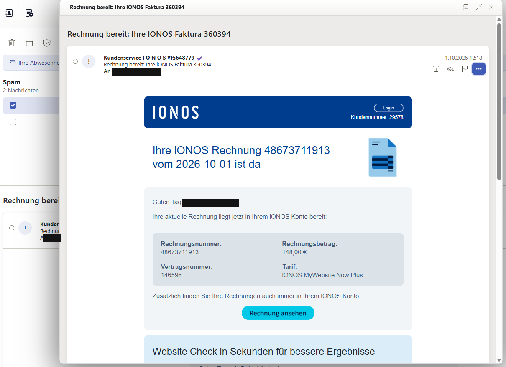

# Mail 2 – „Rechnung bereit: Ihre lΟNΟS Faktura 360394“

> **Rolle:** Blue Team / Phishing-Triage
> **Status:** Header- und Body-Analyse abgeschlossen
> **Hinweis:** Alle Domains, URLs und IPs sind entschärft (`hxxps://`, `[.]`). Opfer-Adresse und -Domain sind durch `victim@[REDACTED]` bzw. `[REDACTED-DOMAIN]` ersetzt.
> **SHA-256 der Original-.eml:** `b9c505a830f9ac831fec9f926566769ea9b0edc8dcc680d57f8b077279c49014`



*Das geklonte IONOS-Rechnungs-Layout mit Logo, Login-Button und „Rechnung ansehen". Sichtbar sind die Fake-Kundennummer 29578 und der Betrag 148,00 €. Empfängeradresse geschwärzt.*

---

## 1. Zusammenfassung (TL;DR)

| Feld | Wert |
|---|---|
| Typ | Credential Phishing, Köder „Rechnung“ (Markenimitation IONOS) |
| Empfangen | 01.10.2026, 12:18:42 MESZ |
| Sichtbare Absenderdomain | `iοnos[.]ćom` (Punycode `xn--inos-0nd[.]xn--om-ula`) |
| Envelope-Absender | `jzwnzojirosrshrjcyp@organicaf[.]com[.]ar` |
| Versandserver | `web04.dinardi[.]com[.]ar` / `159.89.53[.]82` (cPanel-Shared-Hosting) |
| **Auslöser des Versands** | **`45.89.60[.]94`** – hat das PHP-Mailer-Skript aufgerufen |
| Mailer-Skript | `organicaf[.]com[.]ar/e556b83c/m340d483a.php` (PHP 7.2) |
| Ziel-Link | Google-Weiterleitung `hxxps://www.google[.]com/goto?url=[opaker Payload]` |
| Größe | ~345 KB – fast komplett eingebettete Bilder und versteckter Fülltext |

**Bewertung: eindeutig bösartig.** Diese Mail ist deutlich aufwendiger als Mail 1: Sie nutzt ein **geklontes, echtes IONOS-Rechnungs-Template**, versteckt den Link hinter einer **Google-Weiterleitung** und zerlegt den gesamten Text mit **439 unsichtbaren Füllwörtern**. Der wertvollste Fund steckt aber in den Headern: Der kompromittierte Server hat **verraten, welche IP den Versand ausgelöst hat**.

---

## 2. Header-Analyse

### 2.1 Zustellweg (Received-Kette, von unten nach oben)

```
Received: from organica by web04.dinardi.com.ar with local (Exim 4.100.1)
	(envelope-from <jzwnzojirosrshrjcyp@organicaf.com.ar>)
	id 1xCDs8-000000003rV-0nP4
	for victim@[REDACTED];
	Thu, 01 Oct 2026 07:18:40 -0300
```
- **Hop 1 – Ursprung.** `from organica ... with local` bedeutet: Die Mail wurde **lokal** vom Systembenutzer `organica` erzeugt, nicht über SMTP eingeliefert. `organica` ist der cPanel-Account der Website `organicaf[.]com[.]ar`.
- **Exim** ist der Standard-MTA auf cPanel-Servern.
- Zeitzone **-0300** → Server steht in Argentinien bzw. ist auf argentinische Zeit konfiguriert (passt zur `.com.ar`-Domain).

```
Received: from web04.dinardi.com.ar ([159.89.53.82]) by mx.kundenserver.de
 (mxeue103 [212.227.15.188]) with ESMTPS (Nemesis) id 1MbDME-1wayFN1df6-00Zk8b
 for <victim@[REDACTED]>; Thu, 01 Oct 2026 12:18:42 +0200
```
- **Hop 2 – Annahme durch IONOS**, 2 Sekunden nach Erzeugung.
- `web04.dinardi[.]com[.]ar` ist der Webserver eines **argentinischen Hosting-Anbieters**, auf dem viele Kundenseiten liegen (Shared Hosting).

### 2.2 Der wichtigste Fund: cPanel-Abuse-Header

cPanel/Exim fügt automatisch Header ein, die **genau für Abuse-Ermittlungen** gedacht sind. Der Angreifer hat sie nicht entfernt – vermutlich konnte er es gar nicht, weil der Server sie selbst setzt.

```
X-PHP-Script: organicaf.com.ar/e556b83c/m340d483a.php for 45.89.60.94
X-PHP-Originating-Script: 1023:m340d483a.php
X-Source-Args: /opt/cpanel/ea-php72/root/usr/bin/php-cgi
X-Source-Dir: organicaf.com.ar:/public_html/e556b83c
X-AntiAbuse: Primary Hostname - web04.dinardi.com.ar
X-AntiAbuse: Original Domain - [REDACTED-DOMAIN]
X-AntiAbuse: Originator/Caller UID/GID - [1023 993] / [47 12]
X-AntiAbuse: Sender Address Domain - organicaf.com.ar
X-Get-Message-Sender-Via: web04.dinardi.com.ar: authenticated_id: organica/sender_address_domain
X-Authenticated-Sender: web04.dinardi.com.ar: jzwnzojirosrshrjcyp@organicaf.com.ar
```

| Header | Was er verrät |
|---|---|
| `X-PHP-Script` | Die Mail wurde von **`/e556b83c/m340d483a.php`** verschickt – einer PHP-Datei im Webverzeichnis. Das **`for 45.89.60[.]94`** ist die IP, die diese PHP-Datei **per HTTP aufgerufen** hat. |
| `X-Source-Dir` | Pfad `/public_html/e556b83c` – also **öffentlich erreichbar** im Webroot der Website. |
| `X-Source-Args` | PHP **7.2** (`ea-php72`). PHP 7.2 ist seit Ende 2020 **End-of-Life** und bekommt keine Sicherheitsupdates mehr. |
| `X-PHP-Originating-Script` | `1023` = UID des Accounts, das Skript gehört dem Website-Besitzer. |
| `X-Authenticated-Sender` | Der Versand lief über die **legitime Mailfunktion des Accounts**. |

**Rekonstruktion des Angriffs auf den Webserver:**

```
 Angreifer / Bot                 Kompromittierte Website                    Opfer
 45.89.60[.]94   ──HTTP──▶  organicaf[.]com[.]ar/e556b83c/m340d483a.php
                                      │  PHP mail() / Exim
                                      ▼
                            web04.dinardi[.]com[.]ar (159.89.53[.]82)
                                      │  SMTP
                                      ▼
                            mx.kundenserver.de (IONOS) ──▶ Postfach
```

1. Der Angreifer hat sich Zugang zur Website `organicaf[.]com[.]ar` verschafft. Typische Wege: veraltetes CMS/Plugin (passt zu PHP 7.2), gestohlene FTP-/cPanel-Zugangsdaten oder eine bereits vorhandene Webshell.
2. Er hat einen Ordner mit **Zufallsnamen** (`e556b83c`) angelegt und darin ein **PHP-Mailer-Skript** mit Zufallsnamen (`m340d483a.php`) abgelegt. Die Zufallsnamen erschweren das Auffinden durch den Admin.
3. Von **`45.89.60[.]94`** aus ruft er das Skript auf und übergibt Empfänger, Betreff und HTML. Das Skript verschickt die Mail über den **echten Mailserver des Hosters**.
4. Folge: Die Mail kommt von einem Server mit **gutem Ruf** und **besteht SPF** (siehe 2.3).

> **Warum ist das wertvoll?** `45.89.60[.]94` ist näher am Angreifer als jede andere Angabe in beiden Mails. Es kann ein VPS, Proxy oder VPN-Exit des Angreifers sein – direkt bis zur Person führt sie fast nie. Für Blocklisten, Threat Intel und einen Abuse-Report ist sie aber der beste Ansatzpunkt.

> **Blue-Team-Lehre für eigene Server:** Diese Header sind ein Geschenk für Ermittler. Wer selbst Webhosting betreibt, sollte `mail.add_x_header` in PHP aktiviert lassen und Mails aus PHP-Skripten überwachen (Ratenlimits, Alarm bei neuen Skripten, die `mail()` aufrufen).

### 2.3 Authentifizierung (SPF, DKIM, DMARC)

```
Authentication-Results: kundenserver.de; dkim=none; spf=pass
 smtp.mailfrom=jzwnzojirosrshrjcyp@organicaf.com.ar; dmarc=none
 header.from=xn--inos-0nd.xn--om-ula; iprev=pass policy.iprev=159.89.53.82
```

| Prüfung | Ergebnis | Erklärung |
|---|---|---|
| **SPF** | **`pass`** | Der Server `159.89.53[.]82` **darf** für `organicaf[.]com[.]ar` senden – es ist ja der echte Server dieser Domain. |
| **DKIM** | `none` | Keine Signatur. |
| **DMARC** | `none` | Keine Policy für die Lookalike-Domain. |
| **iprev** | `pass` | Reverse-DNS passt. |

**Kernlektion: `spf=pass` heißt nicht „sicher“.** SPF prüft nur, ob der Server für die **Envelope-Domain** senden darf – nicht, ob der Inhalt echt ist, und nicht die sichtbare From-Domain. Kompromittierte legitime Server bestehen SPF zuverlässig. Erst **DMARC** verknüpft SPF/DKIM mit der sichtbaren From-Domain – und genau dafür hat der Angreifer eine eigene Domain ohne DMARC gewählt.

### 2.4 Absender

```
From: "Kundenservice l O N O S #f5648779 =?UTF-8?Q?=E2=9C=94=EF=B8=8F?=" <noreply@xn--inos-0nd.xn--om-ula>
```

Dekodiert: `Kundenservice l O N O S #f5648779 ✔️ <noreply@iοnos.ćom>`

| Element | Technik |
|---|---|
| `l O N O S` | kleines **l** statt **I**, Leerzeichen gegen Keyword-Filter |
| `#f5648779` | Zufälliger Hex-Tag → jeder Absendername einzigartig (Hash-Busting) |
| `✔️` (U+2714 + U+FE0F) | **„Verifiziert“-Haken als Emoji** – imitiert die Verifizierungs-Badges, die manche Mailclients für echte Marken anzeigen (BIMI) |
| `xn--inos-0nd` | `iοnos` mit **griechischem Omikron** (U+03BF) – identisch zu Mail 1 |
| `xn--om-ula` | **`ćom`** mit U+0107 LATIN SMALL LETTER C WITH ACUTE – in Mail 1 war es `čom` (Hatschek). **Gleiches Schema, andere TLD.** |

### 2.5 Betreff

```
Subject: Rechnung bereit: Ihre =?UTF-8?Q?l=CE=9FN=CE=9FS=20Faktura=20=33=36=30=33?=
 =?UTF-8?Q?=39=34=EF=BB=BF=E2=81=A0=E2=80=8D=E2=81=A0=E2=80=8B=E2=81=A0?=
 =?UTF-8?Q?=E2=80=8D=EF=BB=BF?=
```

Dekodiert: `Rechnung bereit: Ihre lΟNΟS Faktura 360394` + **8 unsichtbare Zeichen**

- `lΟNΟS`: kleines **l** und **zwei griechische Omikron** (U+039F)
- Die Ziffern `360394` sind **unnötigerweise** als `=33=36=30...` kodiert – reine Verschleierung, damit Filter die Zahl nicht im Klartext sehen.
- Unsichtbar angehängt: U+FEFF (Byte Order Mark), U+2060 (Word Joiner), U+200D (Zero Width Joiner), U+200B (Zero Width Space) → Hash-Busting, wie in Mail 1.

### 2.6 Message-ID und Datum

```
Message-ID: <1790849920.63b7d2db592d7a1ce879376fc552fde7@organicaf.com.ar>
Date: Thu, 01 Oct 2026 10:18:40 +0000
```
- `1790849920` = **01.10.2026, 10:18:40 UTC** = exakt der Versandzeitpunkt.
- **Format identisch zu Mail 1**: `<Unix-Timestamp>.<32 Hex-Zeichen>@<Domain>` → **gleicher Mailer-Code**. In Mail 1 stand `@campaign`, hier die Domain der kompromittierten Website.

### 2.7 Weitere Header

| Header | Bewertung |
|---|---|
| `Content-Type: text/html` | Wieder **nur HTML**, kein Text-Teil |
| `X-Priority: 3` | Diesmal nur einmal vorhanden (in Mail 1 doppelt) |
| `UI-InboundReport` | IONOS-intern, **für GitHub entfernt** |

---

## 3. Body-Analyse (HTML)

### 3.1 Aufbau: geklontes Original-Template

Das HTML ist ein **professionelles Newsletter-Layout** mit Tabellen, Outlook-Weichen (`<!--[if mso]>`), VML-Namespaces und Meta-Tags wie `x-apple-disable-message-reformatting`. Hinweise, dass es aus einer **echten IONOS-Rechnungsmail kopiert** wurde:

- Interne Bezeichner wie `name="vspace-padding-top-textstage"`, `name="login-btn-margin"`, `<a name="nltop">` (newsletter top) und über 200 generierte IDs (`id="Eju"`, `id="E8s"`, …) → typisch für einen **Template-Generator**, nicht für Handarbeit
- Der Footer enthält das **komplette Impressum** mit Firmensitz, Handelsregister, USt-ID und Hinweis auf das Partnerprogramm
- Signatur mit Name und Funktion einer Führungskraft

**Bedeutung:** Optisch ist die Mail vom Original kaum zu unterscheiden. Ob alle Footer-Angaben dem echten Impressum entsprechen (und ob die Telefonnummer echt ist), prüfen wir in der Infrastruktur-Analyse.

### 3.2 Der sichtbare Inhalt (rekonstruiert)

Nach Entfernen aller versteckten Elemente bleibt dieser Text:

> **Kundennummer:** 29578 – **Ihre lΟNΟS Rechnung** 48673711913 vom 2026-10-01 ist da
> Guten Tag victim@[REDACTED],
> Ihre aktuelle Rechnung liegt jetzt in Ihrem lΟNΟS Konto bereit:
> Rechnungsnummer: 48673711913 – Vertragsnummer: 146596 – **Rechnungsbetrag: 148,00 €** – Tarif: lΟNΟS MyWebsite Now Plus
> Zusätzlich finden Sie Ihre Rechnungen auch immer in Ihrem lΟNΟS Konto.
> *[Werbeblock „Website Check“]*
> Möchten Sie Ihre Rechnung direkt als PDF-Datei per E-Mail erhalten? …
> Beste Grüße, *[Name], CCO lΟNΟS*
> *[Footer: Produkte, Support, Impressum]*

Dazu drei Bilder (siehe [`artifacts/mail2/sichtbare-bilder.png`](../artifacts/mail2/sichtbare-bilder.png)):
- **IONOS-Logo** (als Bild, alt-Text `"man "`)
- **„Login“-Button** (Bild)
- **Rechnungs-Illustration**
- **„Rechnung ansehen“-Button** (Bild)

### 3.3 Extremes Hidden Text Salting – 439 versteckte Wörter

In Mail 1 waren es 4 versteckte Fragmente. Hier sind es **439**, und die Technik ist eine Stufe weiter:

**Jedes sichtbare Wort ist in 2-Buchstaben-Stücke zerlegt**, und zwischen fast jedem Stück steckt ein unsichtbares Füllwort:

```
Was der Mensch sieht:   Kundennummer
Was der Filter liest:   Ku download nd engagement en metaverse nu innovation mm klimaschutz er
```

Das Style-Attribut ist **zeichengenau identisch mit Mail 1**:
```
font-size:0;line-height:0;max-height:0;max-width:0;overflow:hidden;color:transparent;display:inline;mso-hide:all
```

**Die 50 verwendeten Füllwörter** sind harmlose deutsche Trend- und Buzzwörter, am häufigsten: *klimaschutz (16×), engagement, wellness (15×), nachhaltigkeit, online (14×), metaverse, podcast, impfstoff, upload, community (12×)* …

**Zweck – zwei Effekte gleichzeitig:**
1. **Keyword-Zerstörung:** Wörter wie „Rechnung“, „Konto“, „Login“ existieren für den Filter nicht mehr („Re ch nu ng“).
2. **Bayesian Poisoning:** Statistische Spamfilter lernen, welche Wörter typisch für Spam bzw. für legitime Mails sind. Harmlose Wörter wie „nachhaltigkeit“ oder „community“ ziehen den Spam-Score **nach unten**. Die Mail sieht für den Klassifikator aus wie ein Newsletter über Trendthemen.

### 3.4 Homoglyphen im Fließtext

Auch der sichtbare Text ist mit fremden Schriftzeichen durchsetzt:

| Zeichen | Unicode | Anzahl |
|---|---|---|
| `е` | U+0435 CYRILLIC SMALL LETTER IE | 15 |
| `Ο` | U+039F GREEK CAPITAL LETTER OMICRON | 14 (in jedem „lΟNΟS“) |
| `о` | U+043E CYRILLIC SMALL LETTER O | 2 |
| `Р`, `р`, `с`, `Е` | Kyrillisch ER, er, ES, IE | je 1 |

Beispiele: „Wеbsite“, „Nоw Рlus“, „Tiрps“, „SЕ“.

### 3.5 Eingebettete Bilder – 79 Stück, kein externer Abruf

Alle Bilder stecken als **Base64 direkt im HTML** (`src="data:image/png;base64,..."`). Es gibt **keinen einzigen externen Bildaufruf**.

| Bilder | Größe | Funktion |
|---|---|---|
| 4 | unterschiedlich | sichtbarer Inhalt: Logo, Login-Button, Illustration, „Rechnung ansehen“-Button |
| **75** | je 503 × 499 px, ~1,4 KB | **Platzhalter mit fast unsichtbarem Rauschen** (RGBA, Alpha 0–1) |

**Warum Bilder einbetten?**
- Mailclients blockieren **externe** Bilder standardmäßig und zeigen „Bilder laden?“ – das würde misstrauisch machen. Eingebettete Bilder werden sofort angezeigt.
- Es gibt keine Verbindung zu einem Server des Angreifers, die ein Filter beim Scannen bewerten könnte.

**Warum 75 Rausch-Bilder?** Im Original-Template sind das vermutlich 1×1-Pixel-Abstandshalter. Der Angreifer hat sie durch **zufällige, jeweils einzigartige** Bilder ersetzt. Alle 75 haben **verschiedene SHA-256-Hashes** → **Hash-Busting auf Bildebene**. Gleichzeitig blähen sie die Mail auf ~345 KB auf; manche Scanner analysieren große Mails nur teilweise.

### 3.6 Buttons als Bild

„Login“ und „Rechnung ansehen“ sind **Bilder**, kein Text. Ein Filter, der Linktexte auswertet (z. B. „Login“ + externer Link = verdächtig), findet **keinen Text** im Link. Der `<a>`-Tag enthält nur ein ``.

### 3.7 Der Link – Missbrauch einer Google-Weiterleitung

Beide Buttons zeigen auf dieselbe URL:

```
hxxps://www.google[.]com/goto?url=CAESVwHrOzAVcK0cRs5xGM5JQiRENfBWlY97FE5pbuIvRu3L_FNBY1CXClLB5a-trU0VJHesTz4mrzIiimD0ySTxruk95oq7cp7rMa5V59wPn_WiXOgee4pGng
```

- **Domain `google.com`:** bester denkbarer Ruf. Viele Filter und Menschen vertrauen Links auf Google blind.
- Der `url=`-Parameter ist **kein Klartext**, sondern ein Base64url-kodiertes Binärobjekt (91 Bytes, beginnt mit `08 01 12 57` → Protobuf-Struktur). Das eigentliche Ziel ist **verschlüsselt bzw. signiert** und lässt sich ohne Google nicht dekodieren.
- **Folge für die Analyse:** Das endgültige Ziel ist nur durch **Folgen der Weiterleitung** zu ermitteln (machen wir in Schritt 3 isoliert, z. B. per urlscan.io).
- Im Gegensatz zu Mail 1 ist **kein sichtbares Tracking-Token** im Link. Ob die Opfer-Adresse im verschlüsselten Payload steckt, ist offen.

> **Technik:** Open Redirect Abuse – ein vertrauenswürdiger Dienst wird als Sprungbrett genutzt, damit der Link im Mail-Scan „sauber“ aussieht.

### 3.8 Social Engineering

| Element | Psychologischer Hebel |
|---|---|
| „Rechnung bereit“ | **Alltag**: Rechnungen erwartet man, sie wirken harmlos |
| Konkreter Betrag **148,00 €** | **Irritation/Sorge**: Ein unerwarteter Betrag provoziert den Klick „Was ist das?“ |
| Kunden-, Rechnungs-, Vertragsnummer, Tarifname | **Detailtiefe** = Glaubwürdigkeit |
| Echtes Layout, Impressum, Führungskraft | **Autorität und Wiedererkennung** |
| „Login“-Button oben | Führt direkt zur gefälschten Anmeldung |
| Kein Druck, keine Frist | **Subtil**: Keine typischen Spam-Signale wie „sofort“ oder „gesperrt“ |

Mail 1 spielte mit **Angst** (Sicherheitsticket), Mail 2 mit **Neugier und Irritation** (Rechnung). Unterschiedliche Köder für dasselbe Ziel: IONOS-Zugangsdaten.

---

## 4. Indicators of Compromise (IOCs)

| Typ | Wert (entschärft) | Kontext |
|---|---|---|
| IPv4 | **`45.89.60[.]94`** | Hat das Mailer-Skript aufgerufen (Angreifer-Infrastruktur) |
| IPv4 | `159.89.53[.]82` | Versandserver (kompromittiertes Shared Hosting) |
| Hostname | `web04.dinardi[.]com[.]ar` | Versandserver |
| Domain | `organicaf[.]com[.]ar` | Kompromittierte Website |
| URL-Pfad | `organicaf[.]com[.]ar/e556b83c/m340d483a.php` | PHP-Mailer |
| Domain | `xn--inos-0nd.xn--om-ula` (`iοnos[.]ćom`) | Lookalike From-Domain |
| E-Mail | `jzwnzojirosrshrjcyp@organicaf[.]com[.]ar` | Envelope-Absender |
| E-Mail | `noreply@xn--inos-0nd.xn--om-ula` | Header-From |
| URL | `hxxps://www.google[.]com/goto?url=CAESVwHrOzAVcK0c...` | Redirect zum Phishing-Ziel |
| Style-Fingerprint | `font-size:0;line-height:0;max-height:0;max-width:0;overflow:hidden;color:transparent;display:inline;mso-hide:all` | Kit-Signatur (identisch in Mail 1) |
| Message-ID-Muster | `<[unix-ts].[32 hex]@...>` | Mailer-Signatur (identisch in Mail 1) |

---

## 5. MITRE ATT&CK Mapping

| Taktik | Technik | Beobachtung |
|---|---|---|
| Initial Access | **T1566.002** Phishing: Spearphishing Link | Link hinter Bild-Buttons |
| Reconnaissance | **T1598.003** Phishing for Information: Spearphishing Link | Ziel: IONOS-Zugangsdaten |
| Resource Development | **T1584** Compromise Infrastructure | Kompromittierte Website/Hosting als Versandplattform |
| Resource Development | **T1608.005** Stage Capabilities: Link Target | Mailer-Skript im Webroot, Ziel hinter Google-Redirect |
| Defense Evasion | **T1036** Masquerading | Geklontes IONOS-Template, Homograph-Domain |
| Defense Evasion | **T1027** Obfuscated Files or Information | 439 versteckte Wörter, Homoglyphen, Zero-Width-Zeichen, Rausch-Bilder |

---

## 6. Was dieser Fall für Website-Betreiber lehrt

Die Website `organicaf[.]com[.]ar` ist **selbst Opfer**. Ihr Betreiber merkt vermutlich nichts – bis sein Hoster ihn sperrt oder seine Domain auf Blocklisten landet. Für KMU-Beratung:

- **PHP und CMS aktuell halten** – PHP 7.2 ist seit Jahren ohne Sicherheitsupdates
- **Dateiintegrität überwachen** (neue PHP-Dateien im Webroot → Alarm)
- **Ausgehende Mails von Webservern begrenzen** (Rate Limits, Alarm bei Spitzen)
- **Starke, einzigartige Passwörter + 2FA** für Hosting-, FTP- und CMS-Zugänge
- **Logs auswerten:** Der Hoster sieht in den Access-Logs jeden Aufruf von `m340d483a.php` und alle IPs
